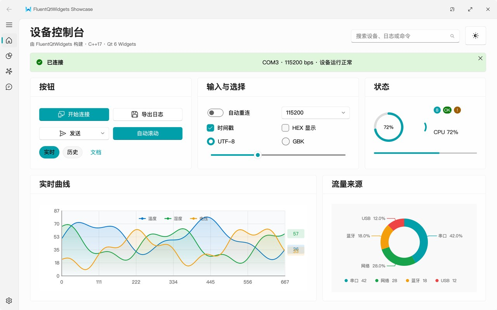
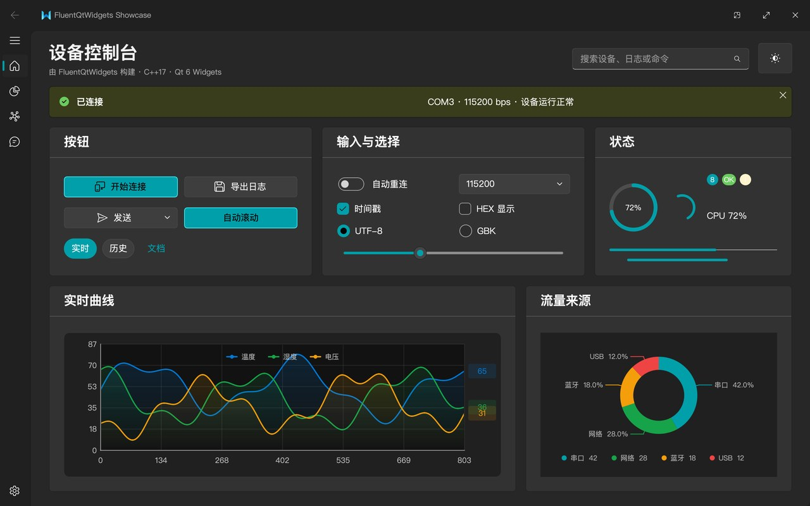
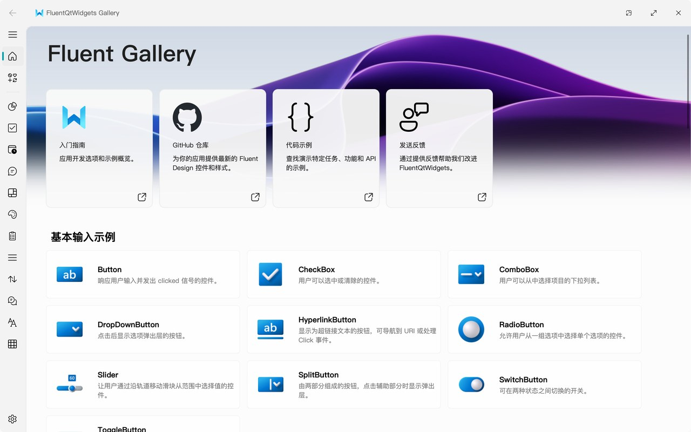
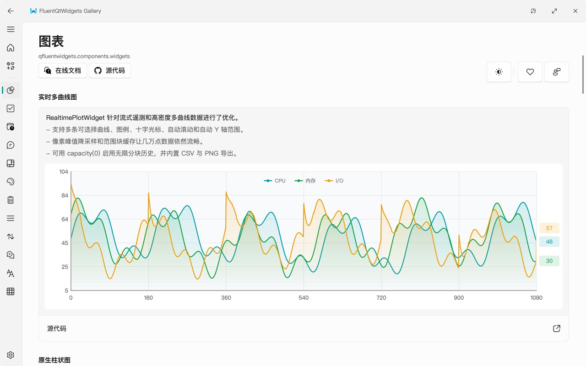
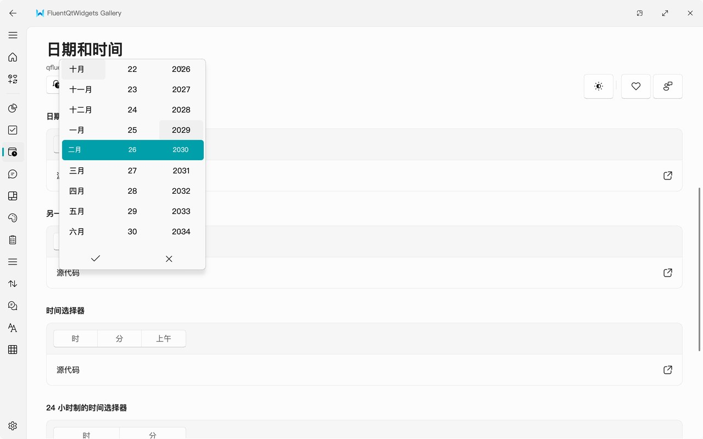
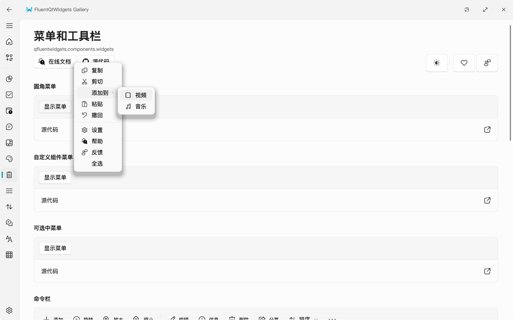

<div align="center">
  
  <h1>FluentQtWidgets</h1>
  <p>面向 C++ / Qt Widgets 的 Fluent Design 控件库</p>
  <p>
    <a href="https://github.com/txp666/FluentQtWidgets/actions/workflows/ci.yml"></a>
    <a href="https://github.com/txp666/FluentQtWidgets/releases/latest"></a>
    <a href="LICENSE"></a>
    
  </p>
  <p>
    <a href="README_EN.md">English</a> · 简体中文 ·
    <a href="https://github.com/txp666/FluentQtWidgets/releases/latest">下载 Gallery</a> ·
    <a href="docs/quick-start.md">快速开始</a> ·
    <a href="CHANGELOG.md">变更记录</a> ·
    <a href="CONTRIBUTING.md">贡献指南</a>
  </p>
</div>

FluentQtWidgets 是一个面向 C++/Qt Widgets 的 Fluent Design 风格控件库，包含可复用控件、独立示例和完整的 Gallery 应用。

本项目是 Python 版 [PyQt-Fluent-Widgets](https://github.com/zhiyiYo/PyQt-Fluent-Widgets) 的 **C++/Qt Widgets 移植版本**。Python 原版是本仓库的行为与视觉基准：控件状态、间距、QSS 常量、示例内容、资源路径、Gallery 页面结构和翻译均尽量对齐上游实现；只有 Qt/C++ 平台行为存在差异时才保留必要调整。

当前发布线：**0.1.10**。本地参考源码、构建目录和开发 agent 元数据不会进入源码发布包。

## 界面预览

<table>
  <tr>
    <td width="50%"></td>
    <td width="50%"></td>
  </tr>
  <tr>
    <td colspan="2" align="center">用本库控件搭建的界面：浅色与深色主题、主题色均可运行时切换</td>
  </tr>
</table>

<p align="center">
  
</p>

<table>
  <tr>
    <td width="50%"><p align="center">Gallery：按分类浏览全部控件</p></td>
    <td width="50%"><p align="center">图表：原生绘制的实时多曲线</p></td>
  </tr>
  <tr>
    <td width="50%"><p align="center">日期与时间：滚轮式选择器</p></td>
    <td width="50%"><p align="center">菜单：圆角菜单与级联子菜单</p></td>
  </tr>
</table>

## 功能特性

- **200+ 控件与组件**：各式按钮（主题色、下拉、分裂、切换、药丸、超链接）、复选框、单选框、开关、滑块、下拉框、输入框、数字框，日期与时间选择器，导航栏、Pivot、分段控件、面包屑与标签页，列表、表格和树视图，对话框、Flyout、TeachingTip、圆角菜单与命令栏，InfoBar、徽章、进度条与进度环，以及设置卡片。
- **原生图表**：`ChartWidget` 使用类 ECharts 的 JSON 配置绘制柱状、折线、面积、环形、散点、雷达、仪表盘与热力图；`RealtimePlotWidget` 适合高密度实时数据流，另有 `AudioWaveformWidget` 波形控件。
- **主题**：浅色、深色或跟随系统，主题色可自定义，均可在运行时切换。自定义控件可用 `FluentStyleSheet::setCustomStyleSheet()` 为两个主题各提供一份样式。
- **窗口与材质**：无边框的 `FluentWindow`、`MSFluentWindow` 与 `SplitFluentWindow`，Windows 11 上的 Mica 背景，亚克力材质的菜单、浮层、输入框与提示。
- **170+ Fluent 图标**，自动适配浅色与深色主题。
- **多语言**：内置简体中文与繁体中文翻译。
- **示例齐全**：75 个可单独运行的示例，以及支持在线更新的完整 Gallery 应用。
- **跨平台**：Windows、macOS 与 Linux，三平台持续集成。

## 快速上手

构建并安装后，在你的 CMake 项目中引用：

```cmake
find_package(Qt6 REQUIRED COMPONENTS Widgets)
find_package(FluentQtWidgets CONFIG REQUIRED)
target_link_libraries(my_app PRIVATE Qt6::Widgets FluentQtWidgets::Widgets)
```

```cpp
#include <FluentQtWidgets/FluentQtWidgets.h>

#include <QApplication>
#include <QVBoxLayout>

using namespace FluentQt;

int main(int argc, char *argv[])
{
    QApplication app(argc, argv);
    ThemeManager::instance()->setTheme(Theme::Auto); // 跟随系统的浅色 / 深色

    QWidget window;
    auto *layout = new QVBoxLayout(&window);
    layout->addWidget(new TitleLabel(QStringLiteral("Hello Fluent")));
    layout->addWidget(new SwitchButton);

    auto *button = new PrimaryPushButton(QStringLiteral("切换主题"));
    QObject::connect(button, &QPushButton::clicked, [] {
        auto *theme = ThemeManager::instance();
        theme->setTheme(theme->effectiveTheme() == Theme::Dark ? Theme::Light : Theme::Dark);
    });
    layout->addWidget(button);

    window.show();
    return app.exec();
}
```

想先看看效果，可以在 [Releases](https://github.com/txp666/FluentQtWidgets/releases/latest) 下载对应平台的 Gallery。

## 应用案例

- [Fluent 串口助手](https://github.com/txp666/FluentSerialAssistant) - 基于 Qt 6 和 FluentQtWidgets 构建的串口调试工具，覆盖串口连接、RX/TX 终端显示、实时曲线、协议解析、记录导出、主题切换和三平台发布打包。

## 环境要求

- CMake 3.21+
- C++17
- Qt 6.5+（Core、Gui、Widgets、Svg、Network）
- 可选 Qt 模块：
  - Multimedia + MultimediaWidgets
  - WebEngineWidgets，仅独立 WebEngine 示例需要

## 构建

```bash
cmake -S . -B build -DFQW_BUILD_EXAMPLES=ON -DFQW_BUILD_TESTS=ON
cmake --build build --parallel
ctest --test-dir build --output-on-failure
```

### 安装 / 引用

```bash
cmake --install build --prefix <install-prefix>
```

```cmake
find_package(FluentQtWidgets CONFIG REQUIRED)
target_link_libraries(my_app PRIVATE FluentQtWidgets::Widgets)
```

### Windows Qt Kit 选择

CMake 使用的编译器和生成器必须与已安装的 Qt kit 匹配。MinGW Qt kit 应使用 MinGW 构建，MSVC Qt kit 应使用 MSVC 构建。如果 CMake 提示找不到 `Qt6Config.cmake`，请通过 `CMAKE_PREFIX_PATH` 指向 Qt kit 根目录，或将 `Qt6_DIR` 设置为包含 `Qt6Config.cmake` 的目录。

仓库内的 `CMakePresets.json` 不写死本机 Qt、编译器或调试器路径。机器相关配置应放在环境变量、IDE kit 选择，或被忽略的 `CMakeUserPresets.json` 中。仓库提供 `CMakeUserPresets.json.example` 作为本地配置模板。

使用本机 Qt MinGW kit 时，先让 Qt kit、MinGW 编译器和 Ninja 对当前终端可见，再使用仓库内的 `mingw-debug` preset：

```powershell
$env:CMAKE_PREFIX_PATH = "<path-to-qt-mingw-kit>"
$env:Path = "<path-to-mingw-bin>;<path-to-ninja-dir>;<path-to-qt-bin>;$env:Path"

cmake --preset mingw-debug
cmake --build --preset mingw-debug --parallel
ctest --preset mingw-debug
```

VS Code 任务会继承启动 VS Code 时的环境。要使用一键构建，可以从已经设置好上述变量的终端启动 VS Code，设置等价的用户环境变量，或复制 `CMakeUserPresets.json.example` 为被忽略的 `CMakeUserPresets.json` 并填入本机路径。Windows 下的 `Gallery: Debug` 使用 `gdb.exe`，因此启动调试前 VS Code 必须能从 PATH 找到 MinGW 的 `bin` 目录。

重新构建前请先关闭正在运行的 Gallery 窗口，否则链接器无法覆盖正在运行的 `.exe`。如果看到 `ninja: error: loading 'build.ninja': The system cannot find the file specified.`，请先运行 `cmake --preset mingw-debug` 重新生成 `build/mingw/build.ninja`，再执行构建。如果 PowerShell 显示重复的 `PATH`/`Path` 环境变量，请先启动干净终端或修正用户环境，否则 MinGW 工具可能没有编译器诊断就失败。

如果使用 Visual Studio/MSVC，请安装匹配的 Qt MSVC kit，并将 `CMAKE_PREFIX_PATH` 或 `Qt6_DIR` 指向该 kit。不要提交本机的 `CMakeUserPresets.json`。

### 启动 Gallery

使用与当前平台匹配的 preset。不同平台使用独立构建目录，因为 CMake 会把生成器、编译器和 Qt kit 缓存在构建目录中。

```bash
# macOS/Linux
cmake --build --preset debug --target FluentQtWidgetsGallery --parallel
./build/debug/examples/gallery/FluentQtWidgetsGallery
# macOS:
# open ./build/debug/examples/gallery/FluentQtWidgetsGallery.app
```

```powershell
# Windows MinGW
cmake --build --preset mingw-debug --target FluentQtWidgetsGallery --parallel
.\build\mingw\examples\gallery\FluentQtWidgetsGallery.exe
```

## 独立示例

macOS/Linux 使用 `--preset debug`，Windows MinGW 使用 `--preset mingw-debug`：

```bash
cmake --build --preset debug --target fqw_basic_input_button_demo --parallel
cmake --build --preset debug --target fqw_basic_input_check_box_demo --parallel
cmake --build --preset debug --target fqw_basic_input_combo_box_demo --parallel
cmake --build --preset debug --target fqw_basic_input_model_combo_box_demo --parallel
cmake --build --preset debug --target fqw_basic_input_radio_button_demo --parallel
cmake --build --preset debug --target fqw_basic_input_slider_demo --parallel
cmake --build --preset debug --target fqw_basic_input_switch_button_demo --parallel
```

全部示例目标可从各 `examples/` 子目录的 `CMakeLists.txt` 查看。

## Gallery 更新（OTA）

Gallery 使用 CMake 项目版本号 `project(... VERSION ...)` 做版本展示和更新比较。默认更新通道是 GitHub Releases。标签、资产和校验规则见 [发布与 OTA](docs/release.md)。

## 文档

- [快速开始](docs/quick-start.md)
- [发布与 OTA](docs/release.md)
- [API 路线图](docs/api-roadmap.md)
- [基础控件](docs/controls-basic.md)
- [架构设计](docs/architecture.md)
- [移植指南](docs/porting-guide.md)
- [贡献指南](CONTRIBUTING.md)

## 构建辅助脚本

- `scripts/generate_vscode_examples.py` 生成 `.vscode/tasks.json` 和 `.vscode/launch.json`。
- `scripts/run_example.py` 可按生成的示例清单运行 demo target。

## 许可

本项目以 **GPL-3.0-or-later** 发布。上游来源与资源授权见 [Third Party Notices](THIRD_PARTY_NOTICES.md)。
