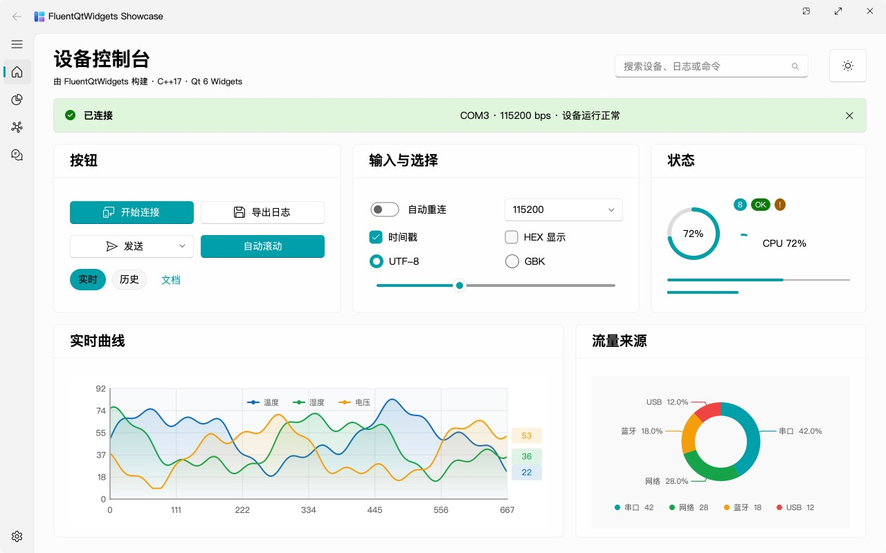
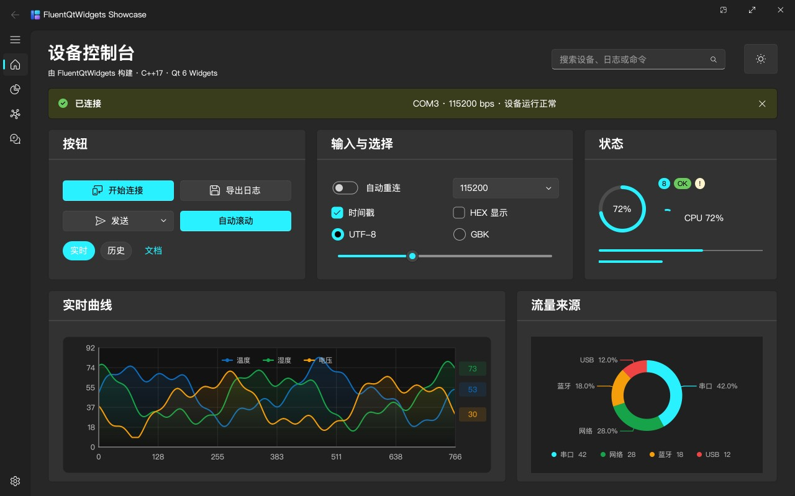
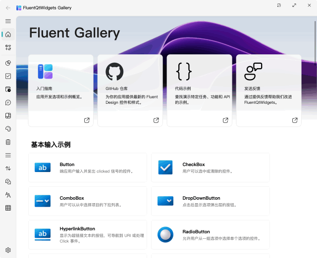
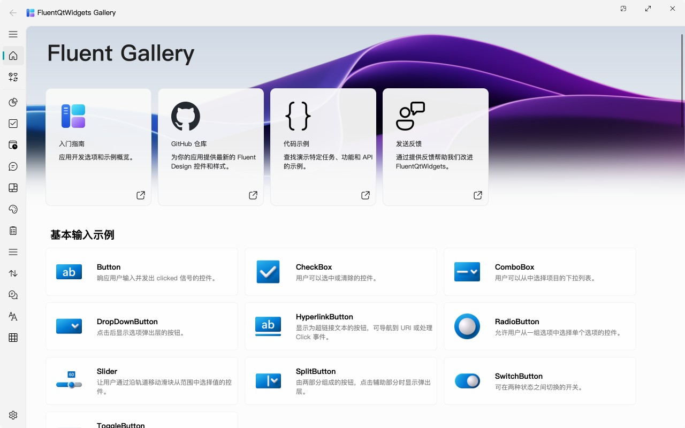
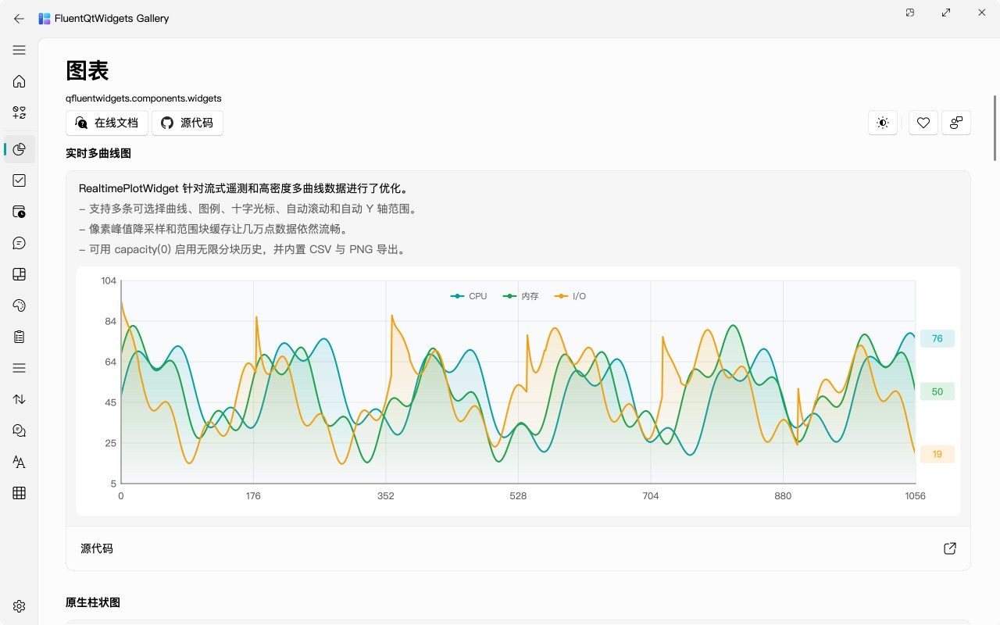
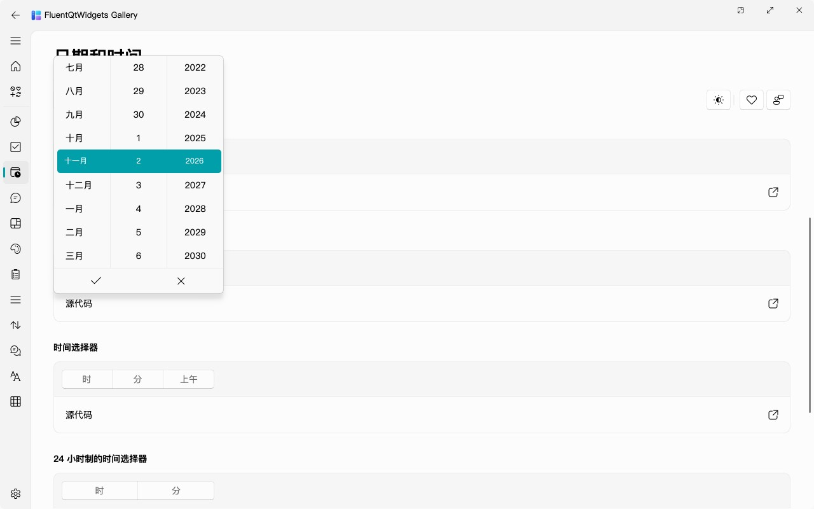
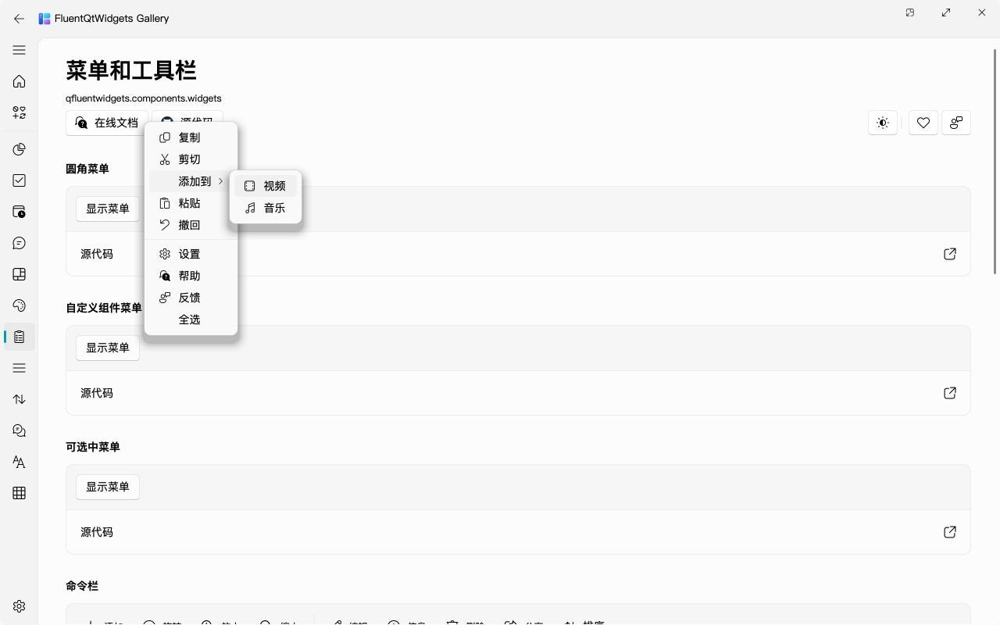

<div align="center">
  
  <h1>FluentQtWidgets</h1>
  <p>面向 C++ / Qt Widgets 的 Fluent Design 控件库</p>
  <p>
    <a href="https://github.com/txp666/FluentQtWidgets/actions/workflows/ci.yml"></a>
    <a href="https://github.com/txp666/FluentQtWidgets/releases/latest"></a>
    <a href="LICENSE"></a>
    
  </p>
  <p>
    <a href="README_EN.md">English</a> · 简体中文 ·
    <a href="https://github.com/txp666/FluentQtWidgets/releases/latest">下载 Gallery</a> ·
    <a href="docs/quick-start.md">快速开始</a> ·
    <a href="CHANGELOG.md">变更记录</a> ·
    <a href="CONTRIBUTING.md">贡献指南</a>
  </p>
</div>

FluentQtWidgets 是一个面向 C++/Qt Widgets 的 Fluent Design 风格控件库，包含可复用控件、独立示例和完整的 Gallery 应用。

本项目是 Python 版 [PyQt-Fluent-Widgets](https://github.com/zhiyiYo/PyQt-Fluent-Widgets) 的 **C++/Qt Widgets 移植版本**。Python 原版是本仓库的行为与视觉基准：控件状态、间距、QSS 常量、示例内容、资源路径、Gallery 页面结构和翻译均尽量对齐上游实现；只有 Qt/C++ 平台行为存在差异时才保留必要调整。

## 界面预览

<table>
  <tr>
    <td width="50%"></td>
    <td width="50%"></td>
  </tr>
  <tr>
    <td colspan="2" align="center">用本库控件搭建的界面：浅色与深色主题、主题色均可运行时切换</td>
  </tr>
</table>

<p align="center">
  
</p>

<table>
  <tr>
    <td width="50%"><p align="center">Gallery：按分类浏览全部控件</p></td>
    <td width="50%"><p align="center">图表：原生绘制的实时多曲线</p></td>
  </tr>
  <tr>
    <td width="50%"><p align="center">日期与时间：滚轮式选择器</p></td>
    <td width="50%"><p align="center">菜单：圆角菜单与级联子菜单</p></td>
  </tr>
</table>

## 功能特性

- **200+ 控件与组件**：各式按钮（主题色、下拉、分裂、切换、药丸、超链接）、复选框、单选框、开关、滑块、下拉框、输入框、数字框，日期与时间选择器，导航栏、Pivot、分段控件、面包屑与标签页，列表、表格和树视图，对话框、Flyout、TeachingTip、圆角菜单与命令栏，InfoBar、徽章、进度条与进度环，以及设置卡片。
- **原生图表**：`ChartWidget` 使用类 ECharts 的 JSON 配置绘制柱状、折线、面积、环形、散点、雷达、仪表盘与热力图；`RealtimePlotWidget` 适合高密度实时数据流，另有 `AudioWaveformWidget` 波形控件。
- **主题**：浅色、深色或跟随系统，主题色可自定义，均可在运行时切换。自定义控件可用 `FluentStyleSheet::setCustomStyleSheet()` 为两个主题各提供一份样式。
- **窗口与材质**：无边框的 `FluentWindow`、`MSFluentWindow` 与 `SplitFluentWindow`，Windows 11 上的 Mica 背景，亚克力材质的菜单、浮层、输入框与提示。
- **170+ Fluent 图标**，自动适配浅色与深色主题。
- **多语言**：内置简体中文与繁体中文翻译。
- **示例齐全**：75 个可单独运行的示例，以及可检查更新的完整 Gallery 应用。
- **跨平台**：Windows、macOS 与 Linux，三平台持续集成。

## 快速上手

构建并安装后，在你的 CMake 项目中引用：

```cmake
find_package(Qt6 REQUIRED COMPONENTS Widgets)
find_package(FluentQtWidgets CONFIG REQUIRED)
target_link_libraries(my_app PRIVATE Qt6::Widgets FluentQtWidgets::Widgets)
```

```cpp
#include <FluentQtWidgets/FluentQtWidgets.h>

#include <QApplication>
#include <QVBoxLayout>

using namespace FluentQt;

int main(int argc, char *argv[])
{
    QApplication app(argc, argv);
    ThemeManager::instance()->setTheme(Theme::Auto); // 跟随系统的浅色 / 深色

    QWidget window;
    auto *layout = new QVBoxLayout(&window);
    layout->addWidget(new TitleLabel(QStringLiteral("Hello Fluent")));
    layout->addWidget(new SwitchButton);

    auto *button = new PrimaryPushButton(QStringLiteral("切换主题"));
    QObject::connect(button, &QPushButton::clicked, [] {
        auto *theme = ThemeManager::instance();
        theme->setTheme(theme->effectiveTheme() == Theme::Dark ? Theme::Light : Theme::Dark);
    });
    layout->addWidget(button);

    window.show();
    return app.exec();
}
```

想先看看效果，可以在 [Releases](https://github.com/txp666/FluentQtWidgets/releases/latest) 下载对应平台的 Gallery。

## 应用案例

- [Fluent 串口助手](https://github.com/txp666/FluentSerialAssistant) - 基于 Qt 6 和 FluentQtWidgets 构建的串口调试工具，覆盖串口连接、RX/TX 终端显示、实时曲线、协议解析、记录导出、主题切换和三平台发布打包。
- [FluentHMI Studio](https://github.com/txp666/FluentHMI-Studio) - 面向硬件工程师的 C++/Qt 6 可视化上位机设计器，支持拖拽控件、绑定串口/TCP/MQTT（Modbus RTU/TCP）数据，并可在一秒内导出无需编译器的独立应用。

## 环境要求

- CMake 3.21+ 与支持 C++17 的编译器
- Qt 6.5+（Core、Gui、Widgets、Svg、Network）
- 可选：Qt Multimedia + MultimediaWidgets，用于媒体控件；Qt WebEngineWidgets，仅独立 WebEngine 示例需要

## 构建

```bash
cmake -S . -B build -DFQW_BUILD_TESTS=ON
cmake --build build --parallel
ctest --test-dir build --output-on-failure
cmake --install build --prefix <install-prefix>
```

示例默认参与构建（`FQW_BUILD_EXAMPLES`）。CMake preset、Windows 下 Qt kit（MinGW 与 MSVC）的选择、运行 Gallery 和 75 个示例，以及在自己的项目中引用本库，见[快速开始](docs/quick-start.md)。

## 文档

- [快速开始](docs/quick-start.md)：构建、运行 Gallery 与示例、引用本库
- [控件](docs/controls.md)：按类别介绍控件，附示例代码
- [架构设计](docs/architecture.md)：库的分层、主题与样式表
- [移植指南](docs/porting-guide.md)：移植如何对齐 Python 原版
- [发布与 OTA](docs/release.md)：版本号、发布标签与 Gallery 更新检查
- [贡献指南](CONTRIBUTING.md) · [变更记录](CHANGELOG.md)

## 许可

本项目以 **GPL-3.0-or-later** 发布。上游来源与资源授权见 [Third Party Notices](THIRD_PARTY_NOTICES.md)。

## 免责声明

- 本项目为社区开源项目，与 Microsoft 以及 PyQt-Fluent-Widgets 原作者无任何隶属、合作或背书关系。Fluent Design、Windows 等名称和商标归其各自所有者所有。
- 本项目按“原样”提供，不附带任何明示或暗示的担保，包括但不限于适销性、特定用途适用性和不侵权担保。详见 GPL-3.0 第 15、16 条。
- 因使用、修改或分发本项目而产生的任何直接或间接损失，作者和贡献者均不承担责任；请在生产环境使用前自行充分测试。
- 使用者应自行确保其使用方式符合 GPL-3.0-or-later、第三方资源授权以及所在地的法律法规。
