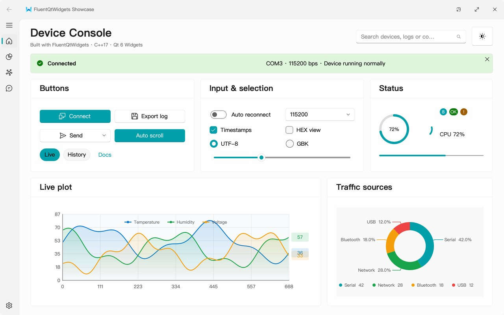
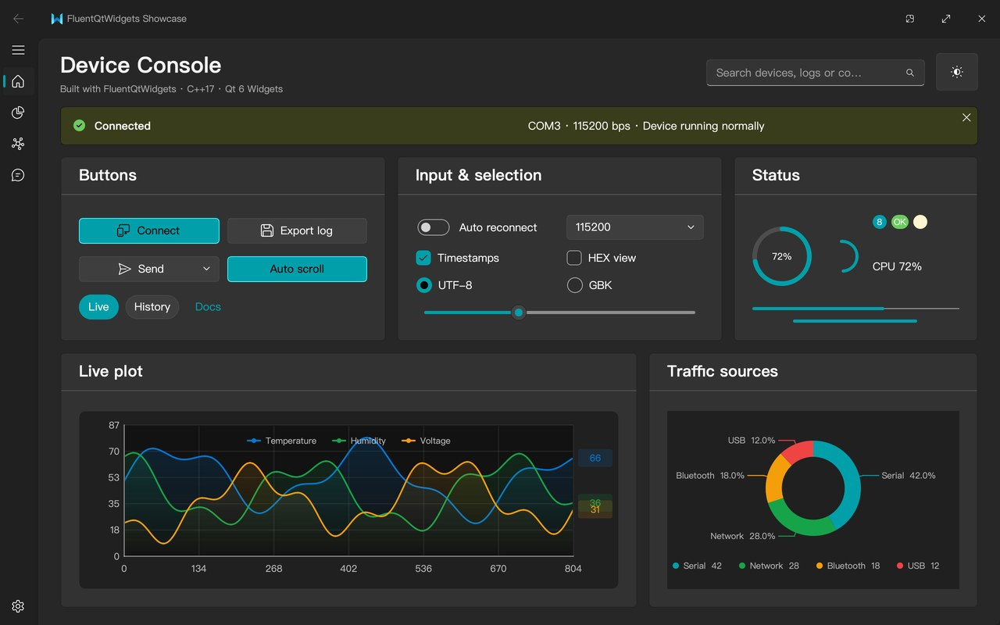
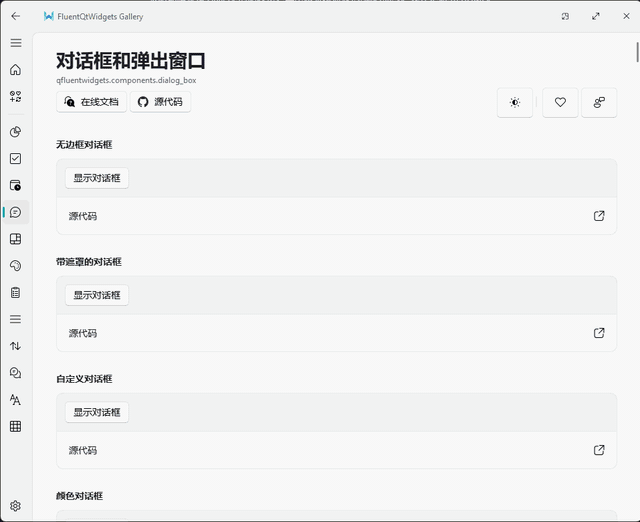
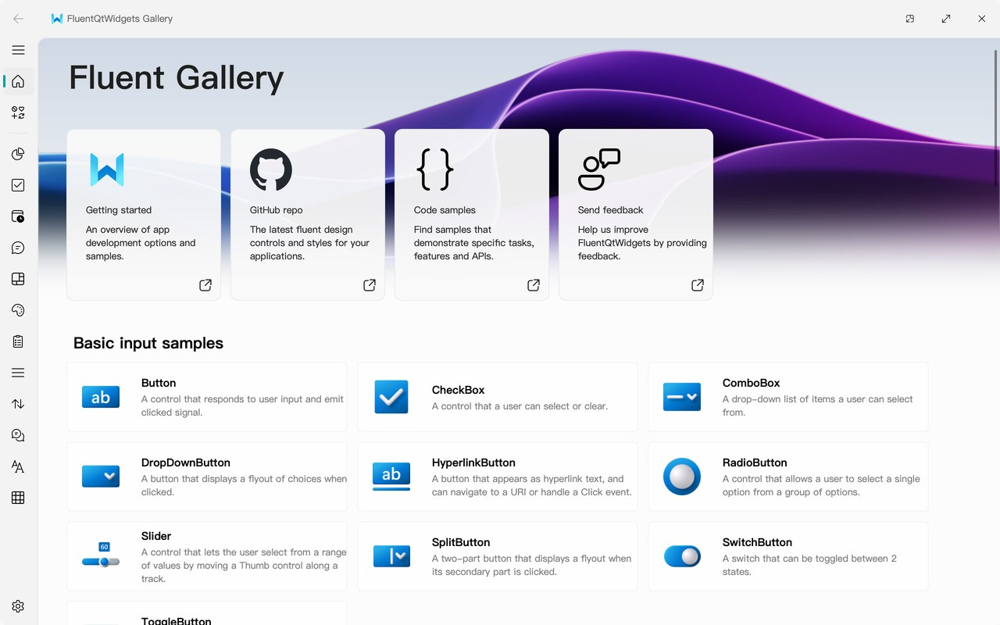
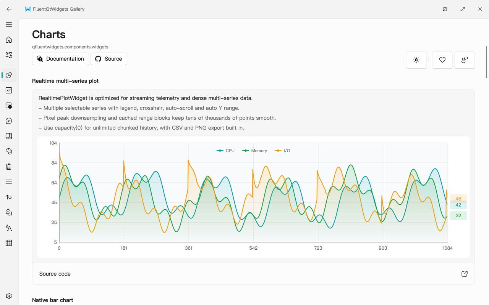
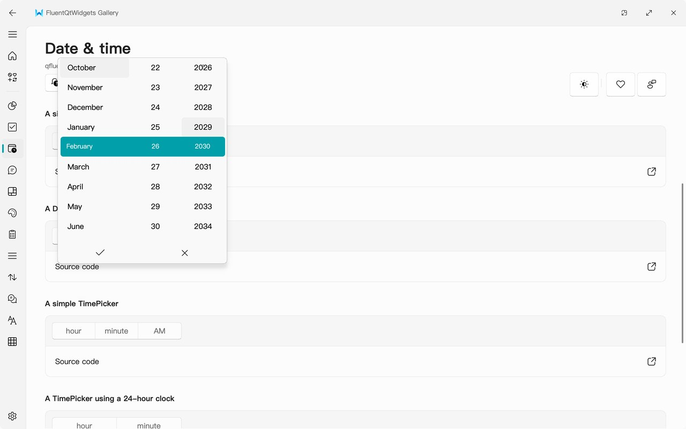
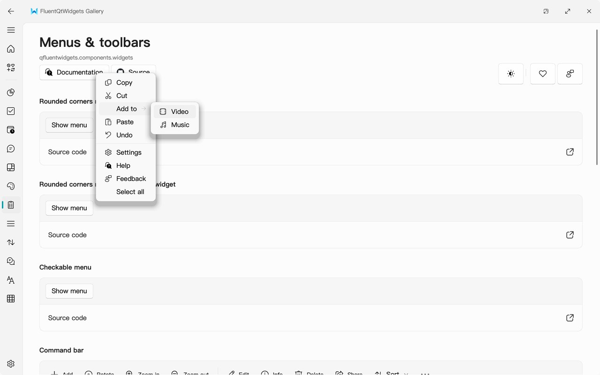

<div align="center">
  
  <h1>FluentQtWidgets</h1>
  <p>Fluent Design widgets for C++ / Qt Widgets</p>
  <p>
    <a href="https://github.com/txp666/FluentQtWidgets/actions/workflows/ci.yml"></a>
    <a href="https://github.com/txp666/FluentQtWidgets/releases/latest"></a>
    <a href="LICENSE"></a>
    
  </p>
  <p>
    English · <a href="README.md">简体中文</a> ·
    <a href="https://github.com/txp666/FluentQtWidgets/releases/latest">Download the Gallery</a> ·
    <a href="docs/quick-start.md">Quick start</a> ·
    <a href="CHANGELOG.md">Changelog</a> ·
    <a href="CONTRIBUTING.md">Contributing</a>
  </p>
</div>

FluentQtWidgets is a Fluent Design widget library for C++/Qt Widgets, with reusable controls, standalone examples and a complete Gallery application.

It is a **C++/Qt Widgets port** of the Python [PyQt-Fluent-Widgets](https://github.com/zhiyiYo/PyQt-Fluent-Widgets). The Python original is the reference for behaviour and looks: control states, spacing, QSS constants, sample content, resource paths, the Gallery's page structure and translations follow upstream as closely as possible, and differ only where Qt/C++ platform behaviour requires it.

Current release line: **0.1.10**. Local reference sources, build directories and development agent metadata are not part of the source release.

## Screenshots

<table>
  <tr>
    <td width="50%"></td>
    <td width="50%"></td>
  </tr>
  <tr>
    <td colspan="2" align="center">A window built from the library's widgets: theme and accent colour switch at run time</td>
  </tr>
</table>

<p align="center">
  
</p>

<table>
  <tr>
    <td width="50%"><p align="center">Gallery: every control, by category</p></td>
    <td width="50%"><p align="center">Charts: a natively drawn realtime multi-series plot</p></td>
  </tr>
  <tr>
    <td width="50%"><p align="center">Date &amp; time: scrolling pickers</p></td>
    <td width="50%"><p align="center">Menus: rounded menus with submenus</p></td>
  </tr>
</table>

## Features

- **200+ widgets and components**: buttons of every kind (accent, drop-down, split, toggle, pill, hyperlink), check boxes, radio buttons, switches, sliders, combo boxes, line edits and spin boxes; date and time pickers; navigation panels, pivots, segmented controls, breadcrumbs and tabs; list, table and tree views; dialogs, flyouts, teaching tips, rounded menus and command bars; info bars, badges, progress bars and rings; setting cards.
- **Native charts**: `ChartWidget` draws bar, line, area, donut, scatter, radar, gauge and heatmap charts from an ECharts-style JSON option; `RealtimePlotWidget` handles dense live data streams; `AudioWaveformWidget` shows waveforms.
- **Theming**: light, dark or follow the system, with a custom accent colour, all switchable at run time. Your own widgets can get one style sheet per theme with `FluentStyleSheet::setCustomStyleSheet()`.
- **Windows and materials**: frameless `FluentWindow`, `MSFluentWindow` and `SplitFluentWindow`, Mica backgrounds on Windows 11, and acrylic menus, flyouts, line edits and tooltips.
- **170+ Fluent icons** that follow the light and dark themes.
- **Translations**: Simplified and Traditional Chinese built in.
- **Plenty of examples**: 75 standalone examples and a complete Gallery application with in-app updates.
- **Cross-platform**: Windows, macOS and Linux, with CI on all three.

## Getting started

After building and installing the library, use it from your CMake project:

```cmake
find_package(Qt6 REQUIRED COMPONENTS Widgets)
find_package(FluentQtWidgets CONFIG REQUIRED)
target_link_libraries(my_app PRIVATE Qt6::Widgets FluentQtWidgets::Widgets)
```

```cpp
#include <FluentQtWidgets/FluentQtWidgets.h>

#include <QApplication>
#include <QVBoxLayout>

using namespace FluentQt;

int main(int argc, char *argv[])
{
    QApplication app(argc, argv);
    ThemeManager::instance()->setTheme(Theme::Auto); // follow the system's light / dark theme

    QWidget window;
    auto *layout = new QVBoxLayout(&window);
    layout->addWidget(new TitleLabel(QStringLiteral("Hello Fluent")));
    layout->addWidget(new SwitchButton);

    auto *button = new PrimaryPushButton(QStringLiteral("Toggle theme"));
    QObject::connect(button, &QPushButton::clicked, [] {
        auto *theme = ThemeManager::instance();
        theme->setTheme(theme->effectiveTheme() == Theme::Dark ? Theme::Light : Theme::Dark);
    });
    layout->addWidget(button);

    window.show();
    return app.exec();
}
```

To try it first, download the Gallery for your platform from [Releases](https://github.com/txp666/FluentQtWidgets/releases/latest).

## Built with FluentQtWidgets

- [Fluent Serial Assistant](https://github.com/txp666/FluentSerialAssistant) - a serial port debugging tool built on Qt 6 and FluentQtWidgets: port connection, RX/TX terminal, live plots, protocol parsing, log export, theme switching, and packages for all three platforms.

## Requirements

- CMake 3.21+
- C++17
- Qt 6.5+ (Core, Gui, Widgets, Svg, Network)
- Optional Qt modules:
  - Multimedia + MultimediaWidgets
  - WebEngineWidgets, only for the standalone WebEngine example

## Building

```bash
cmake -S . -B build -DFQW_BUILD_EXAMPLES=ON -DFQW_BUILD_TESTS=ON
cmake --build build --parallel
ctest --test-dir build --output-on-failure
```

### Installing and linking

```bash
cmake --install build --prefix <install-prefix>
```

```cmake
find_package(FluentQtWidgets CONFIG REQUIRED)
target_link_libraries(my_app PRIVATE FluentQtWidgets::Widgets)
```

### Choosing a Qt kit on Windows

The compiler and generator CMake uses must match the installed Qt kit: build a MinGW Qt kit with MinGW and an MSVC Qt kit with MSVC. If CMake cannot find `Qt6Config.cmake`, point `CMAKE_PREFIX_PATH` at the Qt kit's root, or set `Qt6_DIR` to the directory that contains `Qt6Config.cmake`.

The repository's `CMakePresets.json` does not hard-code local Qt, compiler or debugger paths. Machine-specific settings belong in environment variables, the IDE's kit selection, or an ignored `CMakeUserPresets.json`; `CMakeUserPresets.json.example` is a template for it.

With a local Qt MinGW kit, make the Qt kit, the MinGW compiler and Ninja visible in the terminal first, then use the repository's `mingw-debug` preset:

```powershell
$env:CMAKE_PREFIX_PATH = "<path-to-qt-mingw-kit>"
$env:Path = "<path-to-mingw-bin>;<path-to-ninja-dir>;<path-to-qt-bin>;$env:Path"

cmake --preset mingw-debug
cmake --build --preset mingw-debug --parallel
ctest --preset mingw-debug
```

VS Code tasks inherit the environment VS Code was started with. For one-click builds, start VS Code from a terminal where the variables above are set, set equivalent user environment variables, or copy `CMakeUserPresets.json.example` to an ignored `CMakeUserPresets.json` with your local paths. On Windows, `Gallery: Debug` uses `gdb.exe`, so VS Code must find MinGW's `bin` directory on PATH before debugging.

Close a running Gallery window before rebuilding, or the linker cannot replace the running `.exe`. If you see `ninja: error: loading 'build.ninja': The system cannot find the file specified.`, run `cmake --preset mingw-debug` to regenerate `build/mingw/build.ninja`, then build again. If PowerShell shows duplicate `PATH`/`Path` variables, start a clean terminal or fix the user environment first; otherwise the MinGW tools can fail without a compiler diagnostic.

With Visual Studio/MSVC, install the matching Qt MSVC kit and point `CMAKE_PREFIX_PATH` or `Qt6_DIR` at it. Do not commit your local `CMakeUserPresets.json`.

### Running the Gallery

Use the preset for your platform. Each platform has its own build directory, because CMake caches the generator, compiler and Qt kit in it.

```bash
# macOS/Linux
cmake --build --preset debug --target FluentQtWidgetsGallery --parallel
./build/debug/examples/gallery/FluentQtWidgetsGallery
# macOS:
# open ./build/debug/examples/gallery/FluentQtWidgetsGallery.app
```

```powershell
# Windows MinGW
cmake --build --preset mingw-debug --target FluentQtWidgetsGallery --parallel
.\build\mingw\examples\gallery\FluentQtWidgetsGallery.exe
```

## Standalone examples

Use `--preset debug` on macOS/Linux and `--preset mingw-debug` with Windows MinGW:

```bash
cmake --build --preset debug --target fqw_basic_input_button_demo --parallel
cmake --build --preset debug --target fqw_basic_input_check_box_demo --parallel
cmake --build --preset debug --target fqw_basic_input_combo_box_demo --parallel
cmake --build --preset debug --target fqw_basic_input_model_combo_box_demo --parallel
cmake --build --preset debug --target fqw_basic_input_radio_button_demo --parallel
cmake --build --preset debug --target fqw_basic_input_slider_demo --parallel
cmake --build --preset debug --target fqw_basic_input_switch_button_demo --parallel
```

Every example target is listed in the `CMakeLists.txt` of its `examples/` subdirectory.

## Gallery updates (OTA)

The Gallery shows and compares versions using the CMake project version, `project(... VERSION ...)`. Updates come from GitHub Releases by default. Tags, assets and checksums are described in [Release and OTA](docs/release.md).

## Documentation

- [Quick start](docs/quick-start.md)
- [Release and OTA](docs/release.md)
- [API roadmap](docs/api-roadmap.md)
- [Basic controls](docs/controls-basic.md)
- [Architecture](docs/architecture.md)
- [Porting guide](docs/porting-guide.md)
- [Contributing](CONTRIBUTING.md)

## Helper scripts

- `scripts/generate_vscode_examples.py` generates `.vscode/tasks.json` and `.vscode/launch.json`.
- `scripts/run_example.py` runs demo targets from the generated example manifest.

## License

FluentQtWidgets is released under **GPL-3.0-or-later**. Upstream sources and asset licences are listed in [Third Party Notices](THIRD_PARTY_NOTICES.md).
