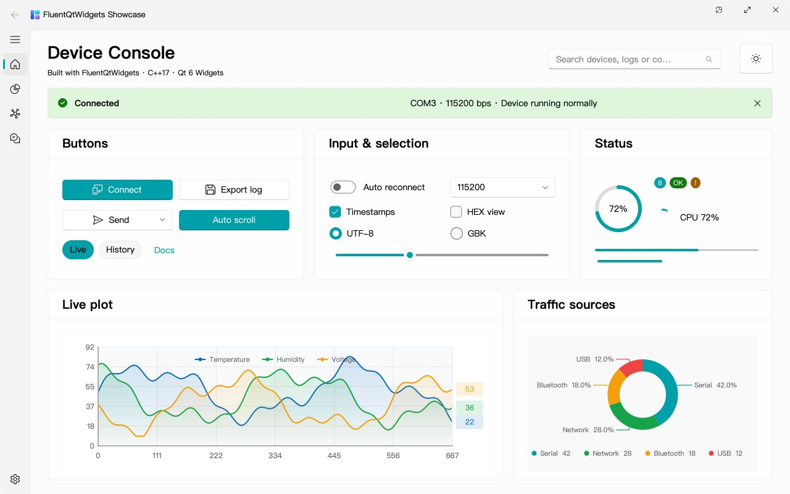
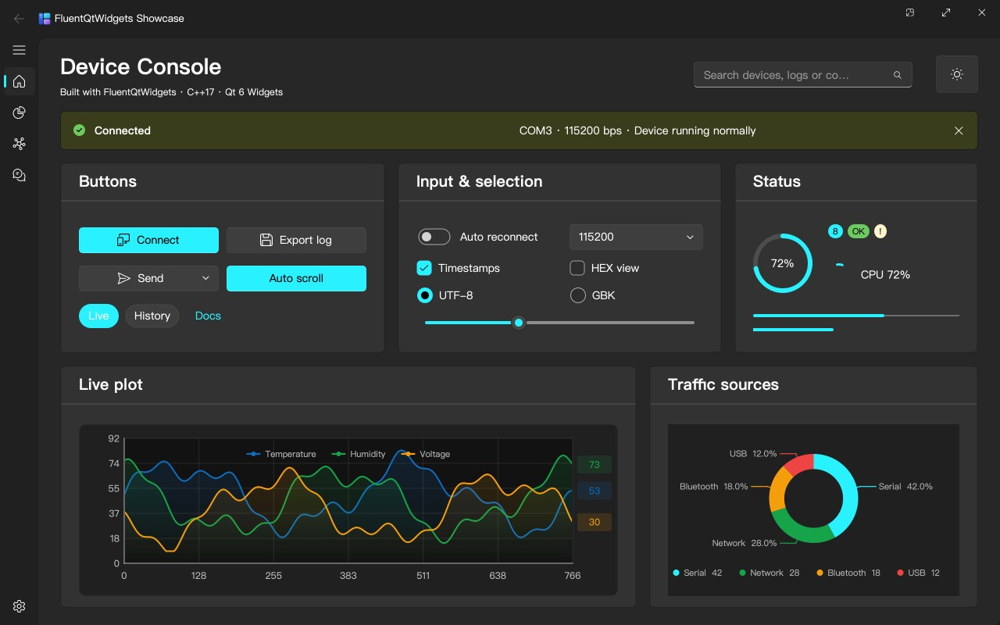
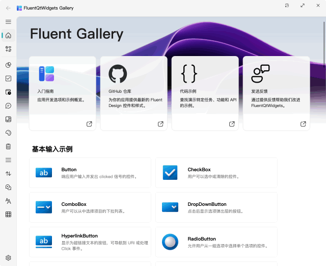
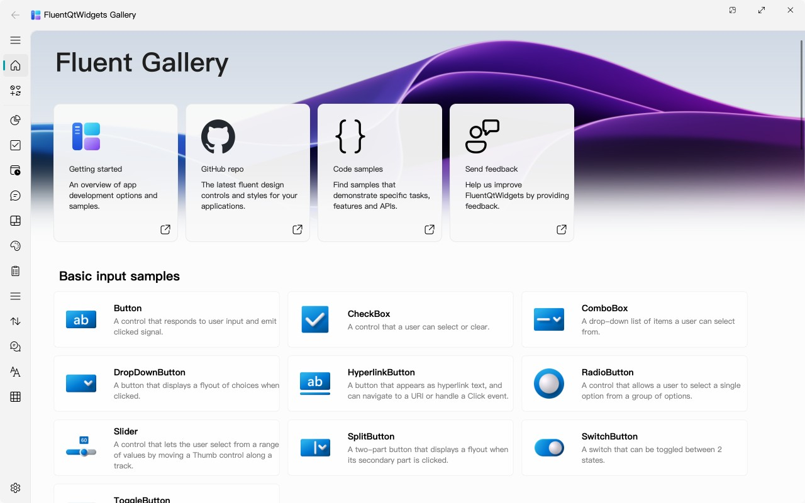
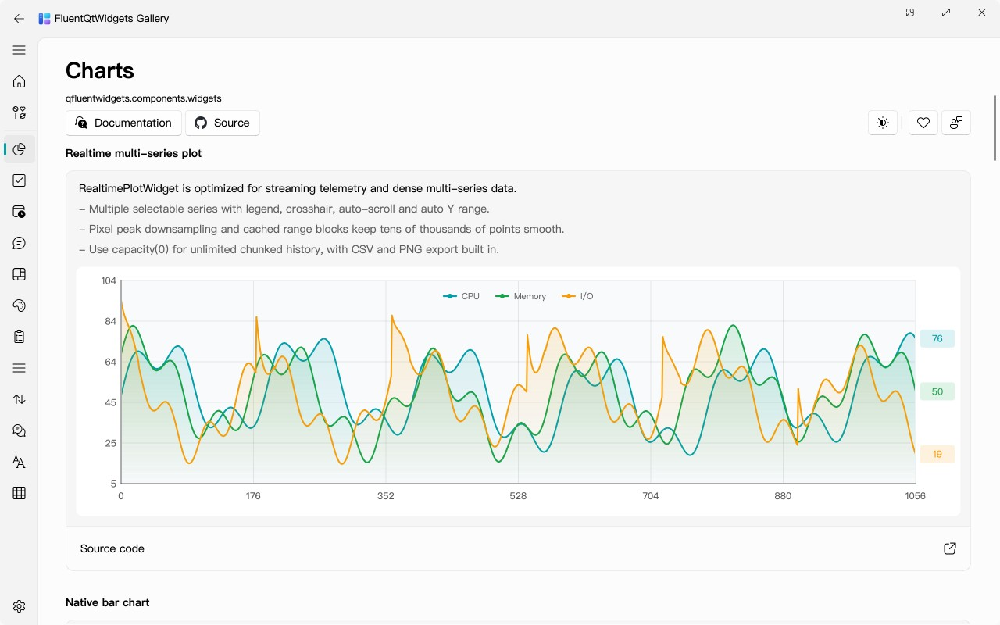
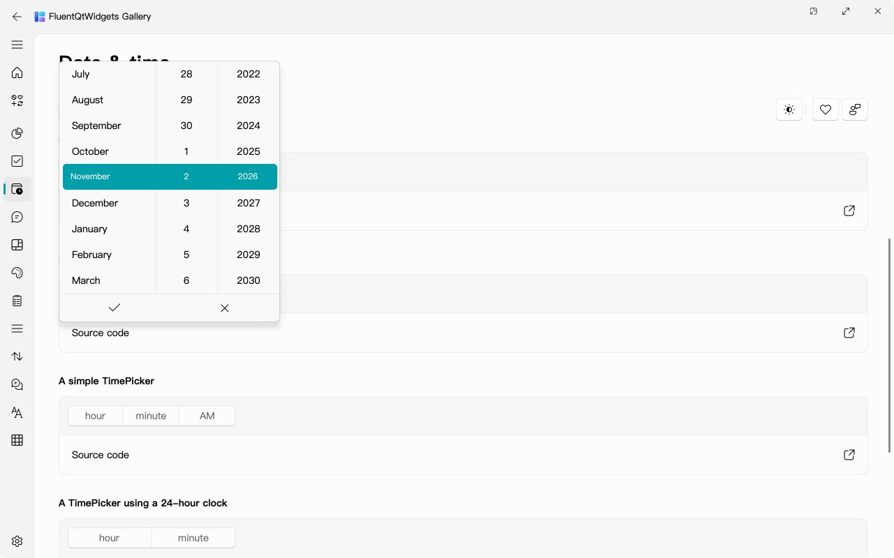
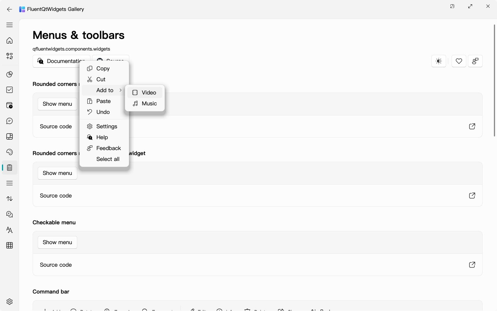

<div align="center">
  
  <h1>FluentQtWidgets</h1>
  <p>Fluent Design widgets for C++ / Qt Widgets</p>
  <p>
    <a href="https://github.com/txp666/FluentQtWidgets/actions/workflows/ci.yml"></a>
    <a href="https://github.com/txp666/FluentQtWidgets/releases/latest"></a>
    <a href="LICENSE"></a>
    
  </p>
  <p>
    English · <a href="README.md">简体中文</a> ·
    <a href="https://fluentqt.modusignal.cn/?lang=en">Website</a> ·
    <a href="https://github.com/txp666/FluentQtWidgets/releases/latest">Download the Gallery</a> ·
    <a href="docs/quick-start.md">Quick start</a> ·
    <a href="CHANGELOG.md">Changelog</a> ·
    <a href="CONTRIBUTING.md">Contributing</a>
  </p>
</div>

FluentQtWidgets is a Fluent Design widget library for C++/Qt Widgets, with reusable controls, standalone examples and a complete Gallery application.

It is a **C++/Qt Widgets port** of the Python [PyQt-Fluent-Widgets](https://github.com/zhiyiYo/PyQt-Fluent-Widgets). The Python original is the reference for behaviour and looks: control states, spacing, QSS constants, sample content, resource paths, the Gallery's page structure and translations follow upstream as closely as possible, and differ only where Qt/C++ platform behaviour requires it.

## Screenshots

<table>
  <tr>
    <td width="50%"></td>
    <td width="50%"></td>
  </tr>
  <tr>
    <td colspan="2" align="center">A window built from the library's widgets: theme and accent colour switch at run time</td>
  </tr>
</table>

<p align="center">
  
</p>

<table>
  <tr>
    <td width="50%"><p align="center">Gallery: every control, by category</p></td>
    <td width="50%"><p align="center">Charts: a natively drawn realtime multi-series plot</p></td>
  </tr>
  <tr>
    <td width="50%"><p align="center">Date &amp; time: scrolling pickers</p></td>
    <td width="50%"><p align="center">Menus: rounded menus with submenus</p></td>
  </tr>
</table>

## Features

- **200+ widgets and components**: buttons of every kind (accent, drop-down, split, toggle, pill, hyperlink), check boxes, radio buttons, switches, sliders, combo boxes, line edits and spin boxes; date and time pickers; navigation panels, pivots, segmented controls, breadcrumbs and tabs; list, table and tree views; dialogs, flyouts, teaching tips, rounded menus and command bars; info bars, badges, progress bars and rings; setting cards; media play bars and a video widget (with Qt Multimedia).
- **Native charts**: `ChartWidget` draws bar, line, area, donut, scatter, radar, gauge and heatmap charts from an ECharts-style JSON option; `RealtimePlotWidget` handles dense live data streams; `AudioWaveformWidget` shows waveforms.
- **Theming**: light, dark or follow the system, with a custom accent colour, all switchable at run time. Your own widgets can get one style sheet per theme with `FluentStyleSheet::setCustomStyleSheet()`.
- **Windows and materials**: frameless `FluentWindow`, `MSFluentWindow` and `SplitFluentWindow`, Mica backgrounds on Windows 11, and acrylic menus, flyouts, line edits and tooltips.
- **170+ Fluent icons** that follow the light and dark themes.
- **Translations**: Simplified and Traditional Chinese built in.
- **Plenty of examples**: 75 standalone examples and a complete Gallery application that checks for updates.
- **Cross-platform**: Windows, macOS and Linux, with CI on all three.

## Getting started

After building and installing the library, use it from your CMake project:

```cmake
find_package(Qt6 REQUIRED COMPONENTS Widgets)
find_package(FluentQtWidgets CONFIG REQUIRED)
target_link_libraries(my_app PRIVATE Qt6::Widgets FluentQtWidgets::Widgets)
```

```cpp
#include <FluentQtWidgets/FluentQtWidgets.h>

#include <QApplication>
#include <QVBoxLayout>

using namespace FluentQt;

int main(int argc, char *argv[])
{
    QApplication app(argc, argv);
    ThemeManager::instance()->setTheme(Theme::Auto); // follow the system's light / dark theme

    QWidget window;
    auto *layout = new QVBoxLayout(&window);
    layout->addWidget(new TitleLabel(QStringLiteral("Hello Fluent")));
    layout->addWidget(new SwitchButton);

    auto *button = new PrimaryPushButton(QStringLiteral("Toggle theme"));
    QObject::connect(button, &QPushButton::clicked, [] {
        auto *theme = ThemeManager::instance();
        theme->setTheme(theme->effectiveTheme() == Theme::Dark ? Theme::Light : Theme::Dark);
    });
    layout->addWidget(button);

    window.show();
    return app.exec();
}
```

To try it first, download the Gallery for your platform from [Releases](https://github.com/txp666/FluentQtWidgets/releases/latest).

## Built with FluentQtWidgets

- [Fluent Serial Assistant](https://github.com/txp666/FluentSerialAssistant) - a serial port debugging tool built on Qt 6 and FluentQtWidgets: port connection, RX/TX terminal, live plots, protocol parsing, log export, theme switching, and packages for all three platforms.
- [FluentHMI Studio](https://github.com/txp666/FluentHMI-Studio) - a C++/Qt 6 visual HMI designer for hardware engineers: drag and drop widgets, bind serial, TCP or MQTT data (Modbus RTU/TCP), and export a standalone app in under a second with no compiler needed.

## Requirements

- CMake 3.21+ and a C++17 compiler
- Qt 6.12 (Core, Gui, Widgets, Svg, Network)
- Optional: Qt Multimedia + MultimediaWidgets for the media widgets (a separately installed Qt Multimedia also needs `QT_ADDITIONAL_PACKAGES_PREFIX_PATH`, see [Quick start](docs/quick-start.md)); Qt WebEngineWidgets only for the standalone WebEngine example

## Building

```bash
cmake -S . -B build -DFQW_BUILD_TESTS=ON
cmake --build build --parallel
ctest --test-dir build --output-on-failure
cmake --install build --prefix <install-prefix>
```

Examples are built by default (`FQW_BUILD_EXAMPLES`). [Quick start](docs/quick-start.md) covers the CMake presets, Windows Qt kits (MinGW and MSVC), running the Gallery and the 75 examples, and using the library from your own project.

## Documentation

- [Quick start](docs/quick-start.md): building, running the Gallery and examples, using the library
- [Controls](docs/controls.md): the widgets by area, with examples
- [Architecture](docs/architecture.md): library layers, themes and style sheets
- [Porting guide](docs/porting-guide.md): how the port follows the Python original
- [Release and OTA](docs/release.md): versions, release tags and Gallery update checks
- [Contributing](CONTRIBUTING.md) · [Changelog](CHANGELOG.md)

## License

FluentQtWidgets is released under **GPL-3.0-or-later**. Upstream sources and asset licences are listed in [Third Party Notices](THIRD_PARTY_NOTICES.md).

## Disclaimer

- This is a community open-source project. It is not affiliated with, sponsored by or endorsed by Microsoft or the author of PyQt-Fluent-Widgets. Fluent Design, Windows and other names and trademarks belong to their respective owners.
- The software is provided "as is", without warranty of any kind, express or implied, including but not limited to merchantability, fitness for a particular purpose and non-infringement. See sections 15 and 16 of the GPL-3.0.
- The authors and contributors are not liable for any direct or indirect damages arising from using, modifying or distributing this project. Test it thoroughly before using it in production.
- You are responsible for making sure your use complies with GPL-3.0-or-later, the third-party asset licences and the laws that apply to you.
